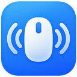
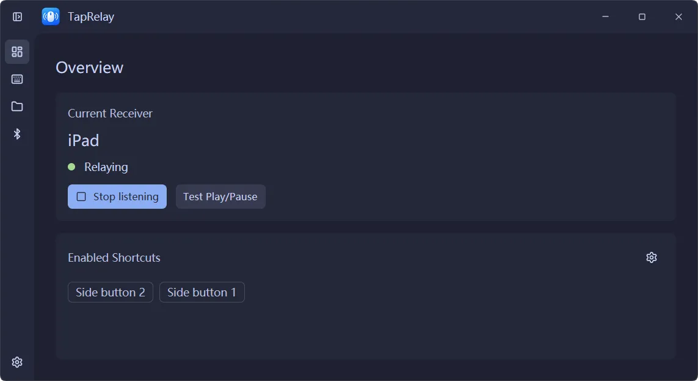

<p align="center">
  
</p>

<h1 align="center">TapRelay</h1>

<p align="center">Control nearby devices from the keyboard and mouse already in your hands.</p>

<p align="center">
  <a href="https://github.com/AuroraZiling/TapRelay/releases/latest"></a>
  <a href="rust-toolchain.toml"></a>
  <a href="LICENSE"></a>
</p>

<p align="center">
  English · <a href="README.zh-cn.md">简体中文</a>
</p>

## ⭐ Features

- 🎵 Bluetooth media controls
- ⌨️ Custom shortcuts and receiver-key mappings
- 🗂️ Application scopes that follow the foreground app
- 🖱️ Full keyboard and mouse passthrough

## 📷 Screenshot

<a href=".github/assets/overview-en.webp"></a>

## 🖥️ Requirements

- Windows x64, or a Mac running macOS 13 or later.
- A Bluetooth adapter and driver that support Bluetooth Low Energy (BLE) peripheral mode.
- A receiver that accepts media controls over BLE HID.
- For custom mappings and passthrough, the receiver must also support the corresponding Bluetooth HID keyboard or mouse input.

## 🚀 Download and use

### Windows

1. Download `TapRelay_<version>_Windows_x64.zip` from [Releases](https://github.com/AuroraZiling/TapRelay/releases) and extract it to a writable folder.
2. Run `TapRelay.exe`. TapRelay requests administrator access by default. If you cancel the request, it continues without elevation, but shortcuts may not work in applications running as administrator.
3. In the setup wizard, enable the functions you need and assign shortcuts.
4. Pair and connect the receiver to the PC in system Bluetooth settings, then select it in TapRelay.
5. Start playback on the receiver and use **Test Play/Pause**.

### macOS

The macOS port is [still in progress](docs/migration-progress.md).

1. Download the macOS ZIP from [Releases](https://github.com/AuroraZiling/TapRelay/releases) and choose:
  - `arm64` for Apple Silicon (M-series) chips
  - `x64` for Intel
2. Extract it and move `TapRelay.app` to Applications.
3. Open TapRelay and follow the prompts to allow Bluetooth, Accessibility and Input Monitoring.
4. In the setup wizard, enable the functions you need and assign shortcuts.
5. In the receiver's Bluetooth settings, pair and connect it to the Mac, then select it in TapRelay.
6. Start playback on the receiver and use **Test Play/Pause**.

To update on macOS, quit TapRelay and replace the app in Applications.

## ⚙️ Settings and environment

- On Windows, the folder you extract TapRelay to must be writable because `config.json` and the `logs/` folder are stored beside `TapRelay.exe`.
- On macOS, open their folders from Settings.
- The default log level is `info`. To record more detail when troubleshooting, run `TapRelay.exe --log-level debug`. Available levels are `off`, `error`, `warn`, `info`, `debug`, and `trace`.
- A device shown as paired or connected in system Bluetooth settings may not yet be able to receive TapRelay commands. If TapRelay reports that the session is not ready, connect to your computer from the receiver's Bluetooth settings, then check the status in TapRelay again.

## ⚠️ Limitations

- With passthrough off, only the main key or mouse button of a matching shortcut is blocked; modifiers (Shift, Ctrl, Alt and Win on Windows; Shift, Control, Option and Command on Mac) still reach the local application. For example, a `Ctrl+P` binding blocks `P`, not Ctrl. Alt or Win combinations may still open system menus or trigger other local system actions.
- Test with your own receiver, Bluetooth adapter, driver and games to confirm compatibility.

<a id="build"></a>

## 🛠️ Build

To build on Windows x64, install:

- rustup to install and manage Rust toolchains.
- Visual Studio Build Tools with the **Desktop development with C++** workload, including MSVC and a Windows SDK (providing `rc.exe` and `fxc.exe`).

From the repository root, install the nightly toolchain specified in `rust-toolchain.toml` and run the app:

```powershell
rustup toolchain install
cargo run --locked -p taprelay-app
```

For full debug symbols, add `--profile debugging` to the run command.

Build the release executable with the same flags as the release workflow:

```powershell
cargo rustc --release --locked -p taprelay-app -- -C target-feature=+crt-static
```

The output is `target/release/taprelay.exe`.

For macOS, see the [build guide](docs/macos.md).

## 💬 Feedback and contributions

Submit bugs and feature requests to [Issues](https://github.com/AuroraZiling/TapRelay/issues).<br>
Read the [Contributing guide](CONTRIBUTING.md) before submitting changes.<br>
Follow the [Code of conduct](CODE_OF_CONDUCT.md) when participating in discussions.

## 💖 Acknowledgements

- The Genshin Impact team and guide video creators: thank you for the work that inspired TapRelay.
- My computer: thank you for providing a reliable Windows test environment.
- Tibo: thank you to the Chief Reset Officer for supporting my Codex usage quota.
- [@DearVa](https://github.com/DearVa)

## 🚨 Compatibility


## 📄 License

TapRelay is licensed under [GPL-3.0-only](LICENSE).

See [THIRD_PARTY_NOTICES](THIRD_PARTY_NOTICES.md) for copied source code, embedded icons and special attribution requirements.
