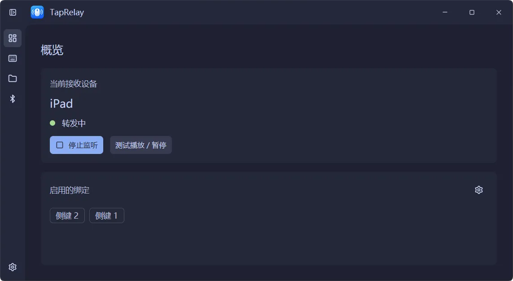

<p align="center">
  
</p>

<h1 align="center">TapRelay</h1>

<p align="center">让正在使用的键鼠自然延伸到身边的设备</p>

<p align="center">
  <a href="https://github.com/AuroraZiling/TapRelay/releases/latest"></a>
  <a href="https://github.com/AuroraZiling/TapRelay/releases"></a>
  <a href="rust-toolchain.toml"></a>
  <a href="LICENSE"></a>
</p>

<p align="center">
  <a href="README.md">English</a> · 简体中文
</p>

## ⭐ 功能

- 🎵 蓝牙媒体控制
- ⌨️ 自定义快捷键与接收端按键映射
- 🗂️ 随前台应用切换的生效范围规则
- 🖱️ 完整键鼠透传

## 📷 截图

<a href=".github/assets/overview-zh.webp"></a>

## 🖥️ 运行条件

- Windows x64 或 运行 macOS 13 及以上版本的 Mac。
- 支持低功耗蓝牙（BLE）外围设备模式的蓝牙适配器及驱动。
- 能通过 BLE HID 接收媒体控制指令的接收设备。
- 对于自定义映射和透传，需要接收端支持相应的蓝牙 HID 键盘或鼠标输入。

## 🚀 下载与使用

### Windows

1. 从 [Releases](https://github.com/AuroraZiling/TapRelay/releases) 下载 `TapRelay_<version>_Windows_x64.zip`，解压到可写入的文件夹。
2. 运行 `TapRelay.exe`。TapRelay 默认请求管理员权限；取消授权后仍会以普通权限运行，但快捷键可能无法用于以管理员身份运行的应用。
3. 在设置向导中启用所需功能，并设置快捷键。
4. 在系统蓝牙设置中将接收设备与电脑配对并连接，然后在 TapRelay 中选择它。
5. 在接收设备上开始播放，使用“测试播放/暂停”。

### macOS

macOS 版本[仍在迁移中](docs/migration-progress.zh-cn.md)。

1. 从 [Releases](https://github.com/AuroraZiling/TapRelay/releases) 下载 macOS ZIP：
  - Apple Silicon (M系列) 芯片选 `arm64`
  - Intel 选 `x64`
2. 解压并将 `TapRelay.app` 放入“应用程序”。
3. 打开 TapRelay，按提示允许蓝牙、辅助功能和输入监控权限。
4. 在设置向导中启用所需功能，并设置快捷键。
5. 在接收设备的蓝牙设置中与 Mac 配对并连接，然后在 TapRelay 中选择它。
6. 在接收设备上开始播放，使用“测试播放/暂停”。

macOS 更新时，退出 TapRelay，再替换“应用程序”中的旧版本。

## ⚙️ 设置与环境

- Windows 解压目录需要允许写入，因为配置文件 `config.json` 和日志文件夹 `logs/` 都保存在 `TapRelay.exe` 旁。
- macOS 可在“设置”中打开相应文件夹。
- 日志默认使用 `info` 等级。排查问题时，可运行 `TapRelay.exe --log-level debug` 记录更多细节；可选等级为 `off`、`error`、`warn`、`info`、`debug`、`trace`。
- 系统蓝牙显示“已配对”或“已连接”，不代表接收设备已经能接收 TapRelay 的指令。如果 TapRelay 显示会话未就绪，请在接收设备的蓝牙设置中连接这台电脑，再检查 TapRelay 中的状态。

## ⚠️ 使用限制

- 未开启透传时，命中快捷键只会拦截普通按键或鼠标按钮，修饰键（Windows 上的 Shift、Ctrl、Alt、Win，Mac 上的 Shift、Control、Option、Command）仍会传给本机。例如，`Ctrl+P` 只拦截 `P`；使用 Alt 或 Win 组合键时，仍可能触发本机的系统菜单等操作。
- 接收设备、蓝牙适配器、驱动和游戏是否兼容，需要实际试用确认。

## 🛠️ 构建

在 Windows x64 上构建，需要安装：

- rustup，用于安装和管理 Rust 工具链。
- Visual Studio Build Tools 的“使用 C++ 的桌面开发”工作负载，包含 MSVC 和 Windows SDK（提供 `rc.exe` 和 `fxc.exe`）。

在仓库根目录执行，安装 `rust-toolchain.toml` 指定的 nightly 工具链并运行：

```powershell
rustup toolchain install
cargo run --locked -p taprelay-app
```

需要完整调试信息时，在运行命令末尾加 `--profile debugging`。

使用与发布流程相同的参数构建发布版本：

```powershell
cargo rustc --release --locked -p taprelay-app -- -C target-feature=+crt-static
```

输出文件为 `target/release/taprelay.exe`。

macOS 构建方式见[构建说明](docs/macos.md)。

## 💬 反馈与贡献

Bug、功能建议提交到 [Issues](https://github.com/AuroraZiling/TapRelay/issues)  
提交改动前阅读[贡献指南](CONTRIBUTING.md)  
参与讨论时遵守[行为规范](CODE_OF_CONDUCT.md)

## 🚨 兼容性


## 💖 致谢

- 原神项目组和攻略视频制作者：感谢他们的作品启发了 TapRelay。
- 我的电脑：感谢它提供不掉链子的 Windows 测试环境。
- Tibo：感谢 Chief Reset Officer 在 Codex 上的额度支持。
- [@DearVa](https://github.com/DearVa)

## 📄 许可

TapRelay 使用 [GPL-3.0-only](LICENSE) 许可。

复制的源码、内嵌图标及特殊署名要求见 [THIRD_PARTY_NOTICES](THIRD_PARTY_NOTICES.md)。
